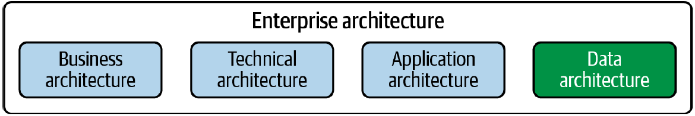
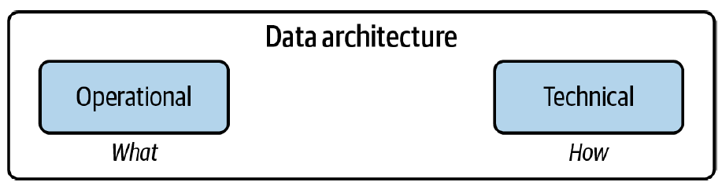
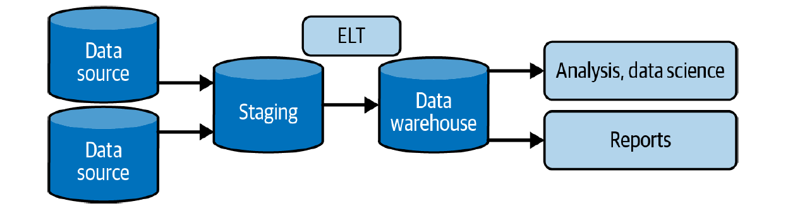

# Parte 1 - Arquitectura de Datos
La arquitectura de datos constituye la base sobre la cual se construyen los sistemas de ingeniería de datos. Su finalidad es diseñar estructuras tecnológicas capaces de responder a las necesidades presentes y futuras de una organización, permitiendo que los datos generen valor para el negocio.

## 1. Arquitectura Empresarial y Arquitectura de Datos

### 1.1 Arquitectura Empresarial

La arquitectura empresarial busca alinear:

- Estrategia empresarial.
- Procesos organizacionales.
- Tecnología.
- Gestión del cambio.

Su objetivo es facilitar la adaptación de la organización ante cambios tecnológicos y de negocio.

#### Conceptos clave

- Cambio organizacional.
- Toma de decisiones.
- Gestión de riesgos.
- Adaptabilidad.
- Evaluación de compromisos (trade-offs).

### 1.2 Arquitectura de Datos

La arquitectura de datos es una especialización de la arquitectura empresarial.

#### Definición

Diseño de sistemas que apoyan las necesidades cambiantes de datos mediante decisiones flexibles y reversibles evaluando cuidadosamente los compromisos entre costo, complejidad, rendimiento y escalabilidad.

#### Objetivos

- Garantizar disponibilidad de datos.
- Permitir crecimiento escalable.
- Facilitar integración.
- Mantener seguridad.
- Reducir deuda técnica.

---

## 2. Componentes de la Arquitectura de Datos

### 2.1 Arquitectura Operacional

Describe qué debe realizarse.

Incluye:

- Procesos de negocio.
- Calidad de datos.
- Gobernanza.
- Reglas empresariales.
- Requerimientos funcionales.

#### Ejemplo

Determinar cuánto tiempo puede transcurrir entre la generación de un dato y su disponibilidad para análisis.

### 2.2 Arquitectura Técnica

Describe cómo se implementará la solución.

Incluye:

- Ingesta de datos.
- Almacenamiento.
- Procesamiento.
- Transformación.
- Exposición de datos.

#### Ejemplo

Diseñar la transferencia de 10 TB por hora desde sistemas operacionales hacia un Data Lake.

---

## 3. ¿Qué es una Buena Arquitectura de Datos?

Una buena arquitectura debe:

### Flexible

Adaptarse a:

- Nuevos requerimientos.
- Nuevas tecnologías.
- Cambios organizacionales.

### Mantenible

Permitir:

- Actualizaciones sencillas.
- Reducción de complejidad.
- Menor costo operativo.

### Reutilizable

Aprovechar:

- Componentes compartidos.
- Servicios comunes.
- Infraestructura estándar.

### Evolutiva

La arquitectura nunca está terminada.

Debe evolucionar continuamente.

---

## 4. Principios de una Buena Arquitectura de Datos

### Principio 1: Elegir Componentes Comunes Sabiamente

#### Objetivo

Estandarizar componentes reutilizables.

#### Beneficios

- Menos duplicidad.
- Mayor colaboración.
- Menores costos.
- Mejor interoperabilidad.

---

### Principio 2: Planificar para el Fallo

Todo sistema terminará fallando.

#### Conceptos Fundamentales

##### Disponibilidad (Availability)

Porcentaje de tiempo que un sistema permanece operativo.

##### Confiabilidad (Reliability)

Probabilidad de cumplir correctamente su función.

##### RTO

Recovery Time Objective.

Tiempo máximo tolerable para recuperar el servicio.

##### RPO

Recovery Point Objective.

Cantidad máxima aceptable de pérdida de datos.

#### Aplicaciones

- Replicación.
- Copias de seguridad.
- Alta disponibilidad.
- Recuperación ante desastres.

---

### Principio 3: Diseñar para la Escalabilidad

#### Escalamiento Vertical
Incrementar:
- CPU.
- RAM.
- Almacenamiento.

#### Escalamiento Horizontal
Agregar más servidores.

#### Elasticidad
Capacidad de crecer o reducir recursos automáticamente.

#### Beneficios
- Soporta picos de carga.
- Optimiza costos.
- Mejora rendimiento.

---

### Principio 4: La Arquitectura es Liderazgo
El arquitecto no sólo diseña sistemas.

También:
- Dirige decisiones técnicas.
- Capacita equipos.
- Comunica estrategias.
- Promueve buenas prácticas.

#### Características del Arquitecto Moderno
- Visión estratégica.
- Conocimiento técnico.
- Capacidad de comunicación.
- Orientación al negocio.

---

### Principio 5: Siempre Estar Arquitectando
La arquitectura es un proceso continuo.

#### Arquitectura Base (Baseline)
Estado actual de la organización.

#### Arquitectura Objetivo (Target)
Estado deseado.

#### Plan de Transición
Ruta para alcanzar la arquitectura objetivo.

#### Enfoque Moderno
- Iterativo.
- Ágil.
- Colaborativo.

---

### Principio 6: Construir Sistemas Débilmente Acoplados

#### Acoplamiento Débil (Loose Coupling)
Los sistemas deben depender lo menos posible entre sí.

#### Características
- Servicios independientes.
- APIs bien definidas.
- Cambios aislados.
- Evolución autónoma.

#### Ventajas
- Facilidad de mantenimiento.
- Mayor velocidad de despliegue.
- Mejor resiliencia.
- Menor impacto de fallos.

---

### Principio 7: Tomar Decisiones Reversibles

#### Decisiones Tipo 1
Difíciles de revertir.

Ejemplo:
- Cambiar completamente la plataforma tecnológica.

#### Decisiones Tipo 2
Fáciles de revertir.

Ejemplo:
- Probar una herramienta analítica nueva.

#### Recomendación
Maximizar decisiones reversibles.
Permiten aprendizaje rápido y menor riesgo.

---

### Principio 8: Priorizar la Seguridad
La seguridad debe incorporarse desde el diseño.

#### Zero Trust
No confiar automáticamente en usuarios o sistemas.

#### Principio de Menor Privilegio
Cada usuario debe tener únicamente los permisos necesarios.

#### Shared Responsibility Model

##### Proveedor Cloud
Responsable de:
- Infraestructura.
- Centros de datos.
- Redes.

##### Cliente
Responsable de:
- Configuración.
- Usuarios.
- Accesos.
- Protección de datos.

#### Áreas de Seguridad
- IAM.
- Cifrado.
- Políticas de acceso.
- Segmentación de red.
- Auditoría.

---

### Principio 9: Adoptar FinOps
FinOps integra:
- Finanzas.
- Operaciones.
- Tecnología.

#### Objetivo
Maximizar valor empresarial minimizando desperdicios.

#### Beneficios
- Optimización del gasto cloud.
- Monitoreo de costos.
- Escalabilidad eficiente.
- Mayor retorno de inversión.

#### Indicadores
- Costo por consulta.
- Costo por procesamiento.
- Costo por almacenamiento.
- Utilización de recursos.

---


# Parte 2 - Arquitecturas Modernas de Datos
Las organizaciones actuales generan cantidades masivas de datos provenientes de aplicaciones web, dispositivos móviles, sensores IoT, redes sociales, sistemas empresariales y múltiples fuentes externas. Para almacenar, procesar, transformar y explotar estos datos se requiere una arquitectura capaz de soportar volumen, velocidad y variedad crecientes.

A lo largo de los años han surgido diferentes arquitecturas de datos que buscan resolver problemas específicos relacionados con almacenamiento, análisis, rendimiento, escalabilidad y gobernanza.

La evolución tecnológica ha impulsado el paso desde arquitecturas tradicionales altamente centralizadas hacia plataformas modernas distribuidas, escalables, orientadas a la nube y capaces de procesar datos en tiempo real.

---

## Evolución de las Arquitecturas de Datos
La evolución de las arquitecturas modernas puede resumirse de la siguiente manera:

```text
Data Warehouse
        ↓
Data Lake
        ↓
Data Lakehouse
        ↓
Modern Data Stack
```

Cada modelo intenta resolver las limitaciones del modelo anterior.

---

## 1. Data Warehouse

### ¿Qué es un Data Warehouse?
Un Data Warehouse (almacén de datos) es una plataforma centralizada diseñada para integrar, organizar y almacenar información proveniente de múltiples sistemas operacionales con el objetivo de facilitar el análisis de negocios y la toma de decisiones.

El concepto fue introducido por Bill Inmon en 1989.

---

### Características principales

#### Orientado al análisis
No está diseñado para operaciones transaccionales.
Su finalidad es responder preguntas como:
- ¿Cuáles fueron las ventas del último trimestre?
- ¿Qué productos generan mayor rentabilidad?
- ¿Cuál es el comportamiento de los clientes?

---

#### Integrado
Los datos provienen de diversas fuentes:
- ERP
- CRM
- Bases de datos corporativas
- Aplicaciones empresariales

---

#### Histórico
Mantiene información de distintos períodos de tiempo.
Permite analizar tendencias y comportamientos históricos.

---

#### Estructurado
Los datos son limpiados, transformados y modelados antes de ser almacenados.

---

### Arquitectura tradicional de un Data Warehouse



---

### ETL
ETL (siglas en inglés de Extract, Transform, Load, o Extracción, Transformación y Carga) es un proceso de integración de datos que toma información de una o varias fuentes, la limpia y estructura, y la guarda en un repositorio central para su análisis.

---

#### Ventajas

- Alta calidad de datos.
- Consistencia empresarial.
- Excelente rendimiento analítico.

---

#### Desventajas

- Procesos ETL complejos.
- Escalabilidad limitada en arquitecturas tradicionales.
- Costos elevados.

---

## 2. Data Mart

### Definición

Un Data Mart es una versión especializada y reducida de un Data Warehouse.

Está orientado a un área específica del negocio.

---

### Ejemplos

#### Data Mart Comercial

Información de ventas.

#### Data Mart Financiero

Información contable y presupuestaria.

#### Data Mart Académico

Información de estudiantes y rendimiento académico.

---

### Beneficios

- Consultas más rápidas.
- Menor complejidad.
- Acceso especializado.

---

## 3. Data Lake

### ¿Qué es un Data Lake?

Un Data Lake es un repositorio masivo diseñado para almacenar datos en cualquier formato.

Su principal filosofía es:

> Guardar primero, procesar después.

---

### Tipos de datos almacenados

#### Estructurados

- Tablas relacionales.
- CSV.

#### Semiestructurados

- JSON.
- XML.

#### No estructurados

- Videos.
- Audio.
- Imágenes.
- Documentos PDF.

---

### Arquitectura básica

```text
Fuentes de Datos
       ↓
    Data Lake
       ↓
Procesamiento
       ↓
Analítica / IA
```

---

### Ventajas

#### Escalabilidad

Permite almacenar petabytes de información.

#### Flexibilidad

Acepta cualquier formato de dato.

#### Bajo costo

Normalmente utiliza almacenamiento cloud basado en objetos.

---

### Problemas históricos

#### Data Swamp

Lago de datos sin organización.

Los datos existen, pero nadie sabe:

- Dónde están.
- Qué significan.
- Cómo utilizarlos.

---

#### Dark Data

Datos almacenados que nunca se utilizan.

---

#### WORN

Write Once, Read Never.

Datos escritos una sola vez y jamás consultados.

---

### Limitaciones

- Problemas de gobernanza.
- Falta de calidad de datos.
- Dificultades de descubrimiento.
- Procesamiento complejo.

---

## 4. Data Lakehouse

### ¿Qué es un Data Lakehouse?

Es una arquitectura híbrida que combina las fortalezas del Data Warehouse y del Data Lake.

Busca mantener:

#### Del Data Warehouse

- Gobernanza.
- Calidad.
- Consistencia.
- Transacciones ACID.

#### Del Data Lake

- Escalabilidad.
- Flexibilidad.
- Soporte para datos no estructurados.

---

### Objetivos

Eliminar la necesidad de mantener dos plataformas independientes.

---

### Arquitectura general

```text
Fuentes de Datos
         ↓
     Lakehouse
         ↓
 ┌──────────────┐
 │ BI           │
 │ Analytics    │
 │ Data Science │
 │ Machine Learn│
 └──────────────┘
```

---

### Beneficios

#### Simplificación

Una única plataforma.

#### Menor costo

Menos infraestructura.

#### Mayor gobernanza

Control sobre los datos.

#### Mejor rendimiento

Procesamiento eficiente para análisis.

---

### Tecnologías populares

- Databricks
- Delta Lake
- Apache Iceberg
- Apache Hudi

---

## 5. Modern Data Stack

### Concepto

El Modern Data Stack (MDS) representa una nueva filosofía arquitectónica basada en componentes modulares conectados entre sí.

En lugar de utilizar plataformas monolíticas, se utilizan herramientas especializadas para cada función.

---

### Filosofía

La idea principal es:

> Utilizar componentes independientes que puedan sustituirse fácilmente.

---

### Componentes principales

#### Ingesta

Herramientas para mover datos.

Ejemplos:

- Fivetran
- Airbyte
- Stitch

---

#### Almacenamiento

Generalmente mediante Data Warehouses Cloud.

Ejemplos:

- Snowflake
- BigQuery
- Redshift

---

#### Transformación

Conversión y modelado de datos.

Ejemplos:

- dbt
- Spark

---

#### Visualización

Consumo de información.

Ejemplos:

- Power BI
- Tableau
- Looker

---

#### Gobernanza

Gestión de calidad y metadatos.

Ejemplos:

- Data Catalog
- DataHub
- Amundsen

---

### Arquitectura típica

```text
Fuentes
   ↓
Fivetran
   ↓
Snowflake
   ↓
dbt
   ↓
Power BI
```

---

### Ventajas

#### Modularidad

Cada herramienta cumple una función específica.

#### Flexibilidad

Fácil reemplazo de componentes.

#### Implementación rápida

Menor tiempo de despliegue.

#### Escalabilidad

Aprovecha servicios cloud completamente gestionados.

---

### Desventajas

#### Dependencia de múltiples proveedores

Mayor complejidad de integración.

#### Costos acumulativos

Cada herramienta posee su propio costo.

---

## 6. Lambda Architecture

### Objetivo

Combinar procesamiento en tiempo real y procesamiento histórico.

---

### Componentes

#### Batch Layer

Procesa información histórica.

---

#### Speed Layer

Procesa eventos en tiempo real.

---

#### Serving Layer

Combina ambos resultados para los usuarios.

---

### Arquitectura

```text
Datos
  ↓
 ┌─────────────┐
 │ Batch Layer │
 └─────────────┘
        ↓
 ┌─────────────┐
 │Speed Layer  │
 └─────────────┘
        ↓
 ┌─────────────┐
 │Serving Layer│
 └─────────────┘
```

---

### Ventajas

- Baja latencia.
- Alta disponibilidad.
- Soporte analítico completo.

---

### Desventajas

- Duplicación de lógica.
- Complejidad elevada.
- Costos operativos altos.

---

## 7. Kappa Architecture

### Objetivo

Simplificar Lambda Architecture.

---

### Principio

Todo es un flujo de eventos.

No existe separación entre:

- Batch.
- Streaming.

---

### Arquitectura

```text
Eventos
   ↓
Streaming Platform
   ↓
Procesamiento
   ↓
Consumo
```

---

### Ventajas

- Menor complejidad.
- Código unificado.
- Arquitectura más limpia.

---

### Limitaciones

- Mayor dependencia del streaming.
- Costos de operación.
- Curva de aprendizaje.

---

## Comparación General

| Arquitectura | Principal Fortaleza | Principal Debilidad |
|-------------|------------------|-----------------|
| Data Warehouse | Calidad y gobernanza | Menor flexibilidad |
| Data Lake | Escalabilidad y costo | Gobernanza limitada |
| Data Lakehouse | Equilibrio entre ambos | Mayor complejidad inicial |
| Modern Data Stack | Modularidad | Dependencia de múltiples herramientas |
| Lambda | Batch + Streaming | Complejidad alta |
| Kappa | Simplicidad conceptual | Dependencia total del streaming |

---

## Conclusiones

Las arquitecturas modernas de datos representan la evolución natural de los sistemas analíticos. El Data Warehouse proporcionó estructura y control; el Data Lake aportó flexibilidad y escalabilidad; el Data Lakehouse integró ambas fortalezas; y el Modern Data Stack consolidó el uso de herramientas modulares orientadas a la nube.

Actualmente, la tendencia predominante es construir plataformas desacopladas, escalables y gobernadas que permitan soportar analítica avanzada, inteligencia artificial y procesamiento en tiempo real, manteniendo costos controlados y capacidad de evolución continua.